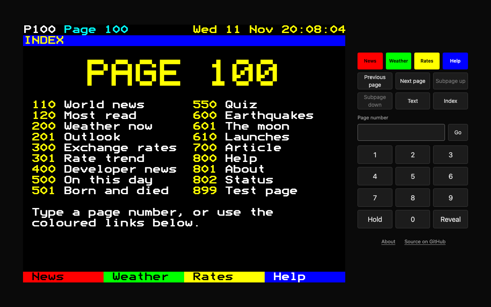
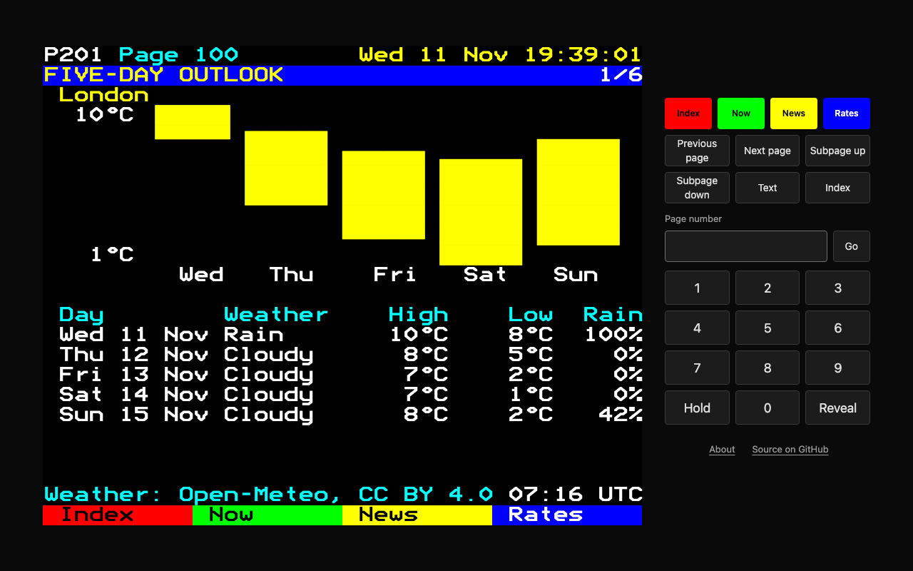
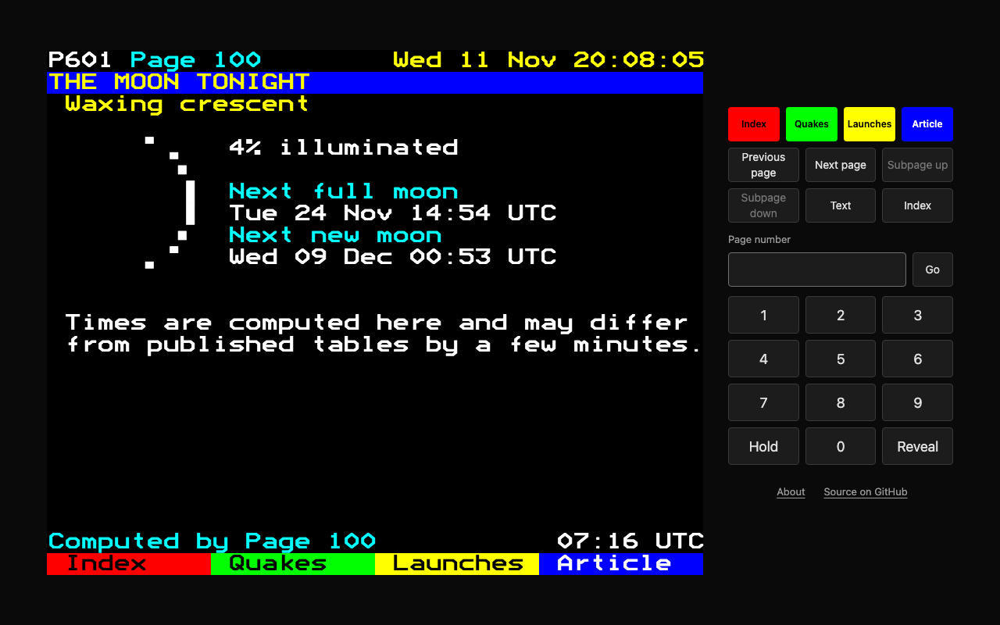
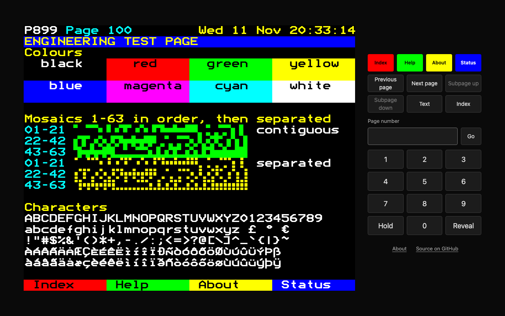
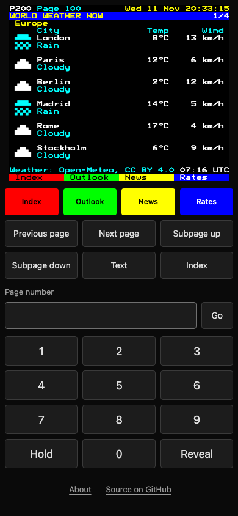

# Page 100

Teletext, brought back. Today's world in 40 columns, 24 rows and three digits.



Teletext was the text service built into televisions from the 1970s until it was switched off in most countries in the 2010s. You typed a three-digit page number on the remote and got one screen: 40 columns by 24 rows, eight colours, chunky block graphics. No scrolling, no adverts, no accounts.

Page 100 serves today's world the same way: news, weather, exchange rates, developer news, earthquakes, rocket launches, the moon, on this day, a quiz. Every page is exactly one screen. An AI editor shortens the news to fit, and a validator decides whether it did. If a page does not fit the grid, it does not ship.

Built for Kiroween 2026, category **Resurrection**. Built with Kiro: see [`.kiro/README.md`](.kiro/README.md).

## Why bring it back

A Page 100 page is a few kilobytes, reads in ten seconds, and never asks you for anything.

- **Small.** The first visit downloads 11,512 bytes in total: HTML, CSS, script and font, brotli-compressed. Every further page is about 1 KB. These numbers are measured by `npm run payload` and a test fails if a budget is exceeded.
- **Works without JavaScript.** Every page is server-rendered HTML with links and a small form. JavaScript only adds the remote-control feel.
- **Works in a terminal.** `curl https://<host>/200` prints the page in colour. `/200.txt` is plain text and `/200.json` is data.
- **Works with a screen reader.** The block-graphics grid is hidden from assistive technology. Each page carries a real text version (headings, lists, tables with header cells) built from the same data, and the T key shows it to everyone.
- **Calm.** No adverts, no tracking, no cookies, no notifications, no infinite anything.

## Using it

Open the site and type three digits.

| Key             | Does                                                    |
| --------------- | ------------------------------------------------------- |
| `0`-`9`         | Enter a page number. The page loads on the third digit. |
| Left, Right     | Previous and next page                                  |
| Up, Down        | Previous and next subpage                               |
| `H`             | Hold: stop the subpages turning                         |
| `R`             | Reveal hidden text (try the quiz on 550)                |
| `T`             | Show the page as plain text                             |
| `I`             | Index (page 100)                                        |
| `Z` `X` `C` `V` | The red, green, yellow and blue links on the bottom row |

On a phone there is a number pad under the screen.

| Pages         | Section                                                 | Source                                           |
| ------------- | ------------------------------------------------------- | ------------------------------------------------ |
| 100           | Index                                                   |                                                  |
| 110, 111-118  | World news, one page per story                          | Wikipedia "In the news" (CC BY-SA 4.0)           |
| 120           | Most read on Wikipedia                                  | Wikimedia feed                                   |
| 200, 201      | Weather now in 24 cities; five-day outlook with a chart | Open-Meteo (CC BY 4.0)                           |
| 300, 301      | Exchange rates; 30-day trend chart                      | ECB reference rates via Frankfurter              |
| 400, 401, 402 | Developer news: top, Show, Ask                          | Hacker News API                                  |
| 500, 501, 550 | On this day: events, births and deaths, and a quiz      | Wikipedia (CC BY-SA 4.0)                         |
| 600, 601, 610 | Earthquakes; the moon tonight; rocket launches          | USGS (public domain); computed; Launch Library 2 |
| 700           | Featured article in one screen                          | Wikipedia (CC BY-SA 4.0)                         |
| 800, 801, 802 | Help; about and licences; live service status           |                                                  |
| 899           | Engineering test page                                   |                                                  |
| 666           | One seasonal page for the hackathon                     |                                                  |

Any other number gets a "page not in service" screen that points to the nearest pages.

|                                                   |                                                   |
| ------------------------------------------------- | ------------------------------------------------- |
|  |  |
|         |          |

## How it works

```
public sources ──> src/sources ──> Snapshot ──> src/compilers ──> content rows ──┐
 (on a schedule,    (zod schemas,                (rules, no model)               │
  never per visit)   recorded fixtures)                                          ├─> frame ─> validateGrid ─> store ─> html / txt / ansi / json
                                         src/editor (Claude, capped) ────────────┘
                                          drafts checked, sent back, or dropped
```

- **The grid is the gate** (`src/grid`). A screen is 24 rows of 40 cells. A cell is a character from a fixed set or one of 63 block mosaics, with a foreground and background from eight colours. `validateGrid` is the only way to get a `ValidPage`, and the store, the cache and every renderer accept nothing else. Text must reach a 4.5:1 contrast ratio, so blue on black is rejected by the validator, not by review.
- **Numbers come from data, words from the editor.** Temperatures, rates, magnitudes and times are placed by code through one formatter module. The AI editor only shortens text it is given.
- **The AI editor is on a short lead** (`src/editor`). It returns plain rows. Each draft is checked for width and row count, for characters outside the set, for any number that is not in the source, and for any capitalised name that is not in the source. A failed draft goes back with the exact violations ("slot background row 1 is 39 cells, limit 38") at most twice. After that the rule-based page is published. Recorded real drafts are in `test/fixtures/editor/`; in the last recording the checks sent back 1 draft of 10.
- **Visitors never trigger a model call or a fetch.** Pages are compiled at boot from a bundled snapshot, so the site is complete in the first second, then refreshed per source on a schedule. Model calls are capped per day and per process, and the first edition waits until the process has been up for ten minutes. Page 802 shows the counters.
- **Without an API key everything still works.** The rule-based compilers build every page. All tests run offline on recorded fixtures.

## Run it

Needs Node 20.19 or later.

```
npm ci
npm run build
npm start            # http://localhost:3000
```

`npm run dev` runs from source. With no `ANTHROPIC_API_KEY` the rule-based compilers publish every page. `REFRESH=off` serves the bundled snapshot only.

| Variable                    | Default           | Use                                                              |
| --------------------------- | ----------------- | ---------------------------------------------------------------- |
| `PORT`                      | `3000`            | HTTP port                                                        |
| `ANTHROPIC_API_KEY`         | unset             | Turns the AI editor on. Never logged, never sent to the browser. |
| `EDITOR_MODEL`              | `claude-opus-5-5` | Model for the editor                                             |
| `EDITOR_CLIENT`             | `anthropic`       | `anthropic`, `fixtures` (replay recorded drafts) or `off`        |
| `MAX_MODEL_CALLS_PER_DAY`   | `60`              | Hard cap per UTC day, per process                                |
| `EDITOR_MAX_CALLS_PER_BOOT` | `30`              | Hard cap per process start                                       |
| `EDITOR_BOOT_DELAY_MS`      | `600000`          | Uptime needed before the first edition                           |
| `EDITOR_MIN_INTERVAL_MS`    | `10800000`        | Minimum time between editions                                    |
| `REFRESH`                   | `on`              | `off` serves the boot snapshot only                              |
| `PUBLIC_ORIGIN`             | unset             | Public URL, sent in the User-Agent to the data sources           |

Deploy: `render.yaml` and the `Dockerfile` target Render's free plan. `npx tsx scripts/runtime-check.ts` proves the image's file layout without Docker.

## Checks

| Command                             | What it proves                                                                                                                                     |
| ----------------------------------- | -------------------------------------------------------------------------------------------------------------------------------------------------- |
| `npm test`                          | 1,211 unit and property tests (62 fast-check properties), offline                                                                                  |
| `npm run typecheck`, `npm run lint` | TypeScript strict, ESLint strict type-checked, Prettier                                                                                            |
| `npm run grid:check`                | Every page compiled from the snapshot and every file in `pages/` is a valid 40 by 24 screen with a matching text alternative: 30 pages, 43 screens |
| `npm run payload`                   | The byte budgets                                                                                                                                   |
| `npm run e2e`                       | 41 browser tests in headless Chromium: keys, phone keypad, no-JavaScript mode, rotation and hold, reveal, focus, no request leaves the origin      |

## Credits and licences

Code: MIT, see `LICENSE`. Font: Bedstead Extended by Ben Harris, public domain, subset to 4,624 bytes; see `public/fonts/README.md`. Data: Wikipedia text is CC BY-SA 4.0; Open-Meteo is CC BY 4.0; exchange rates are European Central Bank reference rates via Frankfurter; USGS data is public domain; Hacker News API; Launch Library 2 by The Space Devs. Page 801 carries the same list.

Page 100 uses the general conventions of teletext (page numbers, a header row, four coloured links, block graphics, reveal, hold). It does not copy the name, layout, numbering or wording of any broadcaster's service.
